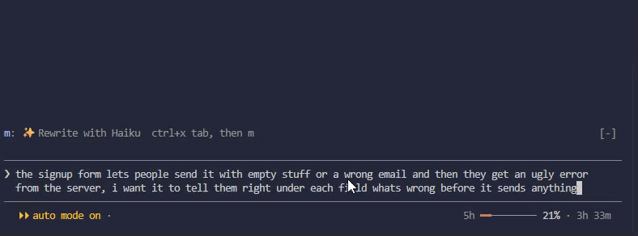

# Better Prompt

A Claude Code mod: Haiku rewrites the draft in your prompt box, clearer and keeping its intent. You read its version above the prompt and choose whether to use it. Nothing is sent for you.



Type a draft, then click **✨ Rewrite with Haiku**, or press `ctrl+x tab` and `m`. When Haiku's version shows:

- **`u` Use** puts it in the box, in place of your draft. Edit it if you like, and send it yourself.
- **`d` Discard** leaves your draft as you typed it.
- **`c` Cancel** stops the call while Haiku works.

```text
❯ hey so the login test keeps failing in ci but works fine on my machine, its in tests/auth.test.ts around line 88 i think, something with the token expiring?? dont change the test itself just tell me whats going on and how to fix it
```

```text
✨ Haiku's version · rewrite cost: 340 in / 75 out  u: Use  d: Discard
The login test fails in CI but passes on my machine. It's in tests/auth.test.ts, around line 88, and I think it has something to do with the token expiring. Don't change the test itself. Explain what's going on and how to fix it.
```

**Read Haiku's version before you use it:** it can drop or add a detail, most of all in pasted logs and code.

## Does it save tokens?

No, it adds them: each rewrite is one more call, to Haiku, and **rewrite cost** is what that call took. It is a clarity tool: it pays off on long or confusing prompts, when it saves a "no, I meant…" turn of the main model. On short, clear prompts, or on pasted logs, skip it.

## Install

```text
/plugin marketplace add bpstack/better-prompt
/plugin install better-prompt@better-prompt
```

Requires a Claude Code version with mods. Built and tested on 2.1.304.

To update, run `claude plugin marketplace update better-prompt`, then `claude plugin update better-prompt@better-prompt`, and `/reload-plugins` in Claude Code. Or let it update on its own: `/plugin` → **Marketplaces** → **better-prompt** → **Enable auto-update** (Claude Code leaves it off for marketplaces outside Anthropic's).

## How it works

One hooks module ([`hooks/register.tsx`](hooks/register.tsx)): it reads the draft with `$.prompt.read()`, sends it to Haiku with `$.model.complete()` and puts the answer in the box with `$.prompt.fill()`. Haiku sees your draft alone, not the conversation, and is told to keep every fact, path, number and doubt, to keep your language, and to add nothing you did not ask.

## Development

```bash
claude plugin validate .
claude plugin test .     # runs hooks/register.test.tsx against the engine
```

### Releasing

Users get a change only when the version goes up: Claude Code installs by `version`, not by tag.

1. Commit the change on its own (`fix(...)`, `feat(...)`), with `validate` and `test` green.
2. Bump `version` in **both** `.claude-plugin/plugin.json` and `.claude-plugin/marketplace.json`, to the same number, in one commit: `chore(marketplace): bump better-prompt to X.Y.Z`.
3. Push.

`X.Y.Z`: `Z` for a fix, `Y` for a feature, `X` for a change that breaks how it is used.

MIT © bpstack
